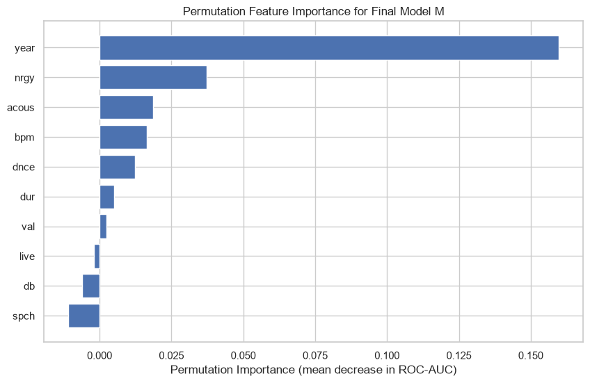
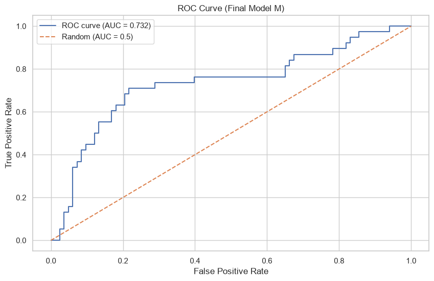

# Predicting Hit Songs Using Audio Features

Can a song's success be predicted using only its audio characteristics, before it is released? This project frames hit prediction as a binary classification task for a small independent music label and compares a baseline with tuned kNN and SVM models.

## Highlights

- **Data**: Spotify Top 10s dataset (`top10s.csv`), 603 songs from 2010–2019, no missing values or duplicates
- **Target**: `hit = 1` if Spotify popularity is 75 or higher, giving **189 hits (31.3%) vs. 414 non-hits (68.7%)**
- **No leakage**: `pop` (used to build the target), title and artist are removed. Scaling runs inside scikit-learn pipelines. `top_genre` is dropped, so the 10 numeric features (year plus 9 audio features) are used.
- **Evaluation**: ROC-AUC and F1, using a stratified 80/20 split, 5-fold CV, and **nested CV** (5 outer / 3 inner folds) with grid search over 20 kNN and 16 SVM settings
- **Feature importance**: permutation importance shows that **year** is by far the strongest feature (mean ROC-AUC drop 0.160), followed by energy and acousticness. Speechiness and loudness add nothing and were removed in an ablation study.

## Results

Default models, single test split and 5-fold CV:

| Model | ROC-AUC (test) | F1 (test) | ROC-AUC (CV) | F1 (CV) |
|---|---|---|---|---|
| Dummy (most frequent) | 0.500 | 0.000 | 0.500 | 0.000 |
| kNN (default) | 0.667 | 0.541 | 0.623 ± 0.030 | 0.374 ± 0.054 |
| SVM (RBF, default) | 0.739 | 0.346 | 0.662 ± 0.027 | 0.308 ± 0.075 |

Tuned models, nested cross-validation:

| Model | ROC-AUC | F1 |
|---|---|---|
| **kNN (tuned)** | **0.678 ± 0.043** | **0.409 ± 0.037** |
| SVM (tuned) | 0.667 ± 0.037 | 0.087 ± 0.112 |

Nested CV selects the tuned kNN as the best model. The fixed SVM used for the feature importance analysis (C=100, gamma=0.01) reaches a test ROC-AUC of 0.732.

<p align="center">
  
  
</p>

Ablation study (fixed SVM, 5-fold CV):

| Setting | ROC-AUC | F1 |
|---|---|---|
| All features | 0.669 ± 0.163 | 0.248 ± 0.197 |
| Without speechiness | 0.688 ± 0.142 | 0.239 ± 0.209 |
| Without loudness | 0.675 ± 0.182 | 0.265 ± 0.177 |
| Without both | 0.686 ± 0.155 | 0.231 ± 0.203 |

Audio features carry some signal (all models beat the baseline), but the prediction is weak: ROC-AUC stays around 0.62–0.74 depending on the setup. Removing the two weakest features changes results by less than the fold-to-fold variation.

## Project structure

| File | Description |
|---|---|
| `experiments.ipynb` | Full project: problem statement, IDA, EDA, baselines, nested CV, permutation importance, ablation, conclusions |
| `top10s.csv` | Dataset |
| `requirements.txt` | Python dependencies |
| `images/` | Charts and screenshots used in this README |

## Data source

[Top Spotify songs from 2010–2019 by year](https://www.kaggle.com/datasets/leonardopena/top-spotify-songs-from-20102019-by-year) on Kaggle. The CSV is ISO-8859-1 encoded.

## How to run

```bash
pip install -r requirements.txt
jupyter notebook experiments.ipynb
```

## Limitations and next steps

- Small dataset (603 songs), and all songs are already chart songs, so "non-hit" means "less popular hit".
- The hit label is a simple popularity threshold. Marketing, artist fame and social media are not in the data.
- `year` dominates the model, so it partly learns era trends rather than audio quality. A version without `year`, or a time-based split, is the next experiment.
- `top_genre` was dropped. One-hot encoding it inside the pipeline could help.
- Decision thresholds and probability calibration could be tuned to the label's preference for not missing hits.

**Author:** Mehdi Gurbanzade · M.Sc. Data Science
